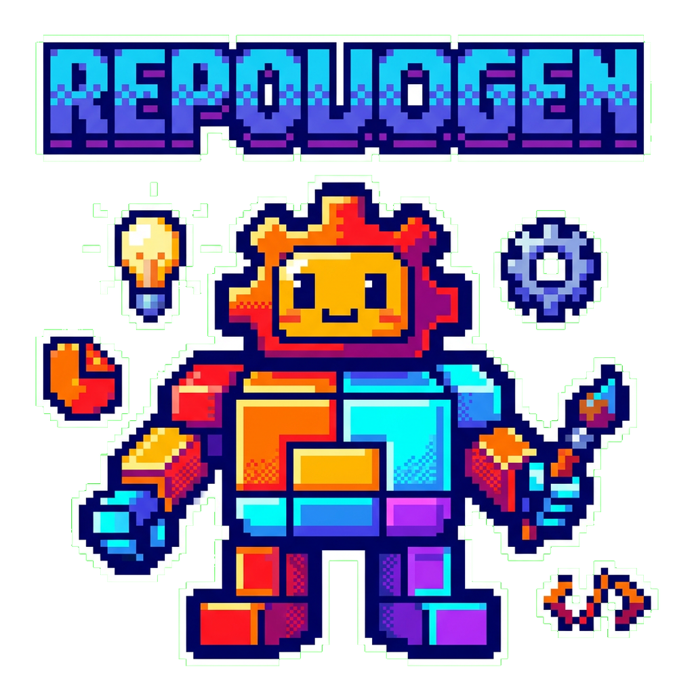

<!-- archive-repo:deprecation-notice:start -->
> [!WARNING]
> **Deprecated**
>
> Repologogen is no longer maintained. Coding agents now include native image generation, so a skill can create complete asset packs without a separate CLI. I now use Codex with the Create Image Assets skill.
<!-- archive-repo:deprecation-notice:end -->

<p align="center">
  
  <br />
  <!-- repo-tagline:start -->
  <strong>🎨 Generate repository logos, brand packs, and platform assets ✨</strong>
  <!-- repo-tagline:end -->
</p>

<p align="center">
  <a href="https://github.com/tsilva/repologogen/blob/main/pyproject.toml"></a>
  <a href="https://github.com/tsilva/repologogen/blob/main/LICENSE"></a>
</p>

repologogen is a Python command-line tool for developers who need logos and matching brand
assets for their projects. Point it at a repository to generate a transparent PNG logo,
or create a pack with icons, favicons, social images, and app store graphics.

It reads the project's files and README to guide generation, then removes the logo's
chromakey background, trims padding, and compresses the output. Model requests go through
AgentBridge, which manages the upstream OpenRouter credentials.

## Install

Requires Python 3.11+, [uv](https://docs.astral.sh/uv/getting-started/installation/), and a
running AgentBridge gateway for generation. Install from source:

```bash
git clone https://github.com/tsilva/repologogen.git
cd repologogen
uv sync --extra dev
uv run repologogen --help
```

Run `uv run repologogen /path/to/project` to write `logo.png` in that project. Existing
output files are overwritten.

## Use

```bash
uv run repologogen /path/to/project --web
uv run repologogen /path/to/project --target web-seo --target google-play --target apple-store
uv run repologogen /path/to/project -s "pixel art" -n "My Project"
```

## Commands

```bash
uv run repologogen                              # generate logo.png in the current project
uv run repologogen --dry-run                    # preview the output plan
uv run repologogen --web                        # write web assets to public/brand
uv run repologogen --target google-play         # include Play icon and feature graphic
uv run repologogen --target apple-store         # include App Store icon
uv run repologogen -o assets/logo.png           # choose the logo output path
uv run repologogen --web --assets-dir branding  # choose the brand pack directory
uv run repologogen --var KEY=VALUE              # pass a prompt-template variable
uv run repologogen --no-trim --no-compress      # skip trimming and PNG compression
uv run repologogen --help                       # list all options
uv run pytest                                  # run tests
uv run ruff check src/ tests/                   # lint
uv run mypy src/repologogen/                    # type check
```

## Notes

- AgentBridge defaults to `http://127.0.0.1:8082/api/v1`. Set `AGENTBRIDGE_BASE_URL`
  to use a different gateway API root and `AGENTBRIDGE_API_KEY` if it requires an
  access token. The CLI does not read upstream keys or fall back to a direct provider.
- Model IDs gain the gateway's `openrouter/` namespace when needed. Use `--model`
  and `--text-model` to override the image and text models.
- Runtime settings come from built-in defaults and CLI flags; settings files are not read.
- `--dry-run` skips image generation and file writes, but README analysis and metadata
  extraction can still make text-model requests.
- `--web` implies `core-brand`, adds the `web-seo` target, and writes assets to
  `public/brand`. It also writes `web-seo-metadata.json` and `web-seo-metadata.ts`
  in the target project for Next.js integration.
- Each `--target` implies `core-brand`; targets can be combined. Without `--web`,
  brand packs default to `repologogen-assets`. All output paths are relative to
  the target project unless absolute.
- Brand packs write `<assets-dir>/manifest.json`; override it with `--manifest`.
- Install or refresh [$repologogen_generate-brand-assets](skills/repologogen_generate-brand-assets/SKILL.md) with
  `python3 scripts/install_codex_skill.py` or `make install-skill`.

## License

[MIT](LICENSE)

## Agent Vault access for local AI calls

For agent-operated AI requests, use the opt-in repository launcher:

```sh
mkdir -p .internal/agent-vault/work
python3 -I -S scripts/infisical/agentbridge_vault.py check --workspace "$PWD/.internal/agent-vault/work"
python3 -I -S scripts/infisical/agentbridge_vault.py run --workspace "$PWD/.internal/agent-vault/work" -- --help
```

The workspace must be `.internal/agent-vault/work` under this checkout, or a
subdirectory of it; broader directory overrides are rejected.

Pass the ordinary tool arguments after `--`. The workspace is the working
directory and the only writable directory under the user's home. Stage only
explicitly selected non-secret inputs and profiles there. The launcher uses an
isolated HOME inside that directory, skips dotenv loading, and does not discover
existing personal profiles, caches or credentials. Worktrees and changes to the
native binding/guard require a separate trusted profile review; never borrow a
different repository's profile or inject a raw key as a fallback.

The reviewed service mapping is bundle `local-repologogen-agentbridge`, service
`repologogen-agentbridge-0`, for `127.0.0.1:8082` GET `/api/v1/models` and POST
`/api/v1/chat/completions`. The native `.infisical.yaml` uses YAML's JSON subset
and pins this repository's metadata-only Development identity and
`/agents/agentbridge` folder. No service keys are copied into or read from that
folder. The gateway's existing upstream Agent Vault route owns provider keys.

The protected profile under
`~/.config/infisical/agentbridge-python/profiles/repologogen.json` pins native and
launcher hashes, the dedicated bundle, Python environment, HTTPS instance, proxy
and public CA. The child receives `agentbridge_public_placeholder` and a scoped
proxy capability. The native Agent Vault session plus an enforced OS sandbox
blocks other egress, home credential reads and credential-helper execution.
Trust is process-local; global shell, CA trust and MCP/app defaults are unchanged.
Trusted setup and full-access host processes remain outside the child boundary.

Fake tests exercise the actual application HTTP client, rejection sanitization,
placeholder guards and filesystem/network restrictions. `check` is a bounded
live catalog GET; it does not establish live inference availability. Prompts,
documents, uploads and generation require the usual separate content approval.
Models, normal tool entrypoints and production behavior are unchanged. External
image download hosts and non-Python conversion executables are not enabled;
unsupported operations stop explicitly without broadening access or falling back.
Use synthetic fixtures for checks; never process personal documents as migration
validation. Run `python3 -m unittest discover -s tests -p test_agentbridge_vault.py`
for the offline boundary regressions.
